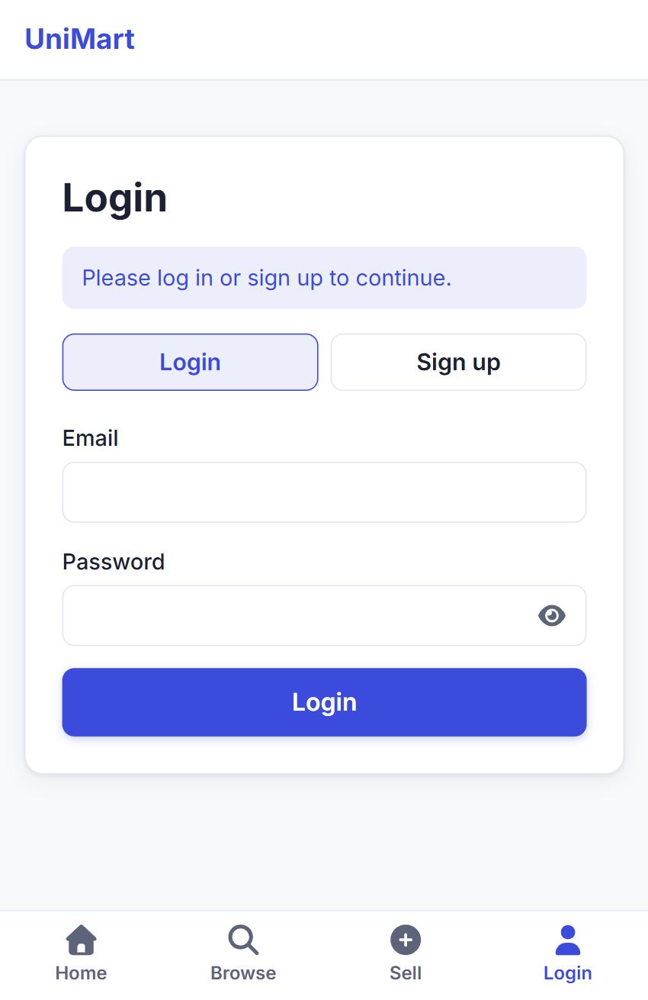
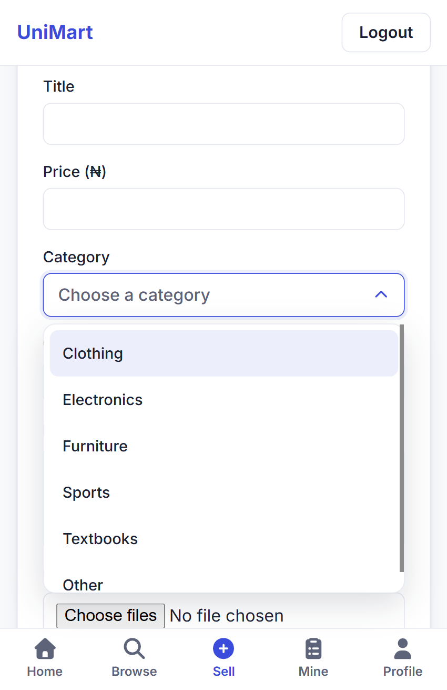

# UniMart

A web app where university students buy and sell items (textbooks, gadgets, clothes, furniture) with each other. Buyers contact sellers directly on WhatsApp, so there is no chat system to build or run.

<p align="center">
  
  
  
  
</p>
<p align="center"><sub>Login and sign up &middot; Browse &middot; Listings &middot; Sell an item</sub></p>

**Live demo:** coming soon.

## Features

- **Accounts:** sign up and log in, change password, and log out of all other devices if a phone is lost.
- **Phone numbers the way people write them:** sign up with `0801 234 5678`; the app stores `+2348012345678`, which WhatsApp links need.
- **Listings:** post, edit, delete and mark as sold, with up to 5 photos each (checked by real file content, 5 MB each).
- **Browse:** search, category filter, sorting and pages. Sold items stay in the list after the available ones, with a round "Sold" badge.
- **Listing page:** photo gallery, seller card, safety tip, and a "Contact seller on WhatsApp" button that opens a chat with a ready-made message. On phones the button stays fixed at the bottom of the screen.
- **Login-only browsing:** the listings and sellers' contact details are only visible to logged-in users, both on the screen and in the API.
- **Made for phones:** responsive layout, a bottom tab bar, and a custom dropdown and notification system.

## Tech stack

| Part | Tools |
|---|---|
| Frontend | React, Vite, React Router, plain CSS (design tokens as CSS variables), Font Awesome |
| Backend | Python, Flask, Flask-SQLAlchemy, Flask-Migrate, Flask-JWT-Extended, Flask-CORS |
| Database | PostgreSQL |

## Project structure

```
backend/     Flask API (routes/, models.py, migrations/, uploads/)
frontend/    React app (src/pages, src/components, src/index.css)
CLAUDE.md    Notes for AI coding assistants working on this repo
```

## Run it on your own computer

You need **Python 3**, **Node.js** and **PostgreSQL** installed.

### 1. Database

Create an empty database named `campus_marketplace` (for example with `psql` or pgAdmin).

### 2. Backend

```bash
cd backend
pip install -r requirements.txt
```

Copy `.env.example` to `.env` and fill it in (your database password and two long random secret keys; the file explains how to generate them). Then create the tables:

```bash
python -m flask --app app db upgrade
```

Add the categories (safe to run more than once):

```bash
python seed.py
```

Start the API on port 5000:

```bash
python app.py
```

### 3. Frontend

In a second terminal:

```bash
cd frontend
npm install
npm run dev
```

Open the address it prints (usually http://localhost:5173). Vite forwards `/api` requests to the Flask server, so no extra setup is needed.

To try it on a phone, expose the Vite port with a tunnel such as `ngrok http 5173`.

## Security notes

- Passwords are stored as salted hashes, never in plain text.
- Login tokens last 3 days and carry a version number, so a user can cut off every other device at once.
- Uploaded photos get random file names and are checked by their actual content.
- Login and signup are rate limited (wrong passwords are counted per email), and the app refuses to start in production without real secrets.
- Secrets live in `backend/.env`, which is not committed.

## Deploying

In production, Flask serves the built React site and the API from one address, and `gunicorn` runs the app.

1. **Build the site:** `cd frontend && npm install && npm run build` (makes `frontend/dist`).
2. **Install the Python packages:** `cd backend && pip install -r requirements.txt`.
3. **Set these environment variables** on the host (never put them in a file in the repo):
   - `FLASK_ENV=production`: the app then refuses to start unless the secrets below are real.
   - `SECRET_KEY` and `JWT_SECRET_KEY`: two different random values, each at least 32 characters.
   - `DATABASE_URL`: the production PostgreSQL address.
   - `UPLOAD_FOLDER`: where photos are stored (point it at a permanent disk, or photos vanish on restart).
   - Optional: `TRUSTED_PROXIES` (default 1), `LOGIN_FAIL_LIMIT`, `SIGNUP_LIMIT`, `RATELIMIT_STORAGE_URI`.
4. **Create the tables:** `python -m flask --app app db upgrade`.
5. **Add the categories:** `python seed.py` (safe to run twice).
6. **Start the server:** `gunicorn wsgi:app` (run from the `backend` folder; settings are in `gunicorn.conf.py`).

## Status

Works end to end on desktop and on phones, and is ready for a first deployment. Still to do: choose a host and permanent photo storage, forgot-password by email, reporting a listing, and previewing and removing single photos.
